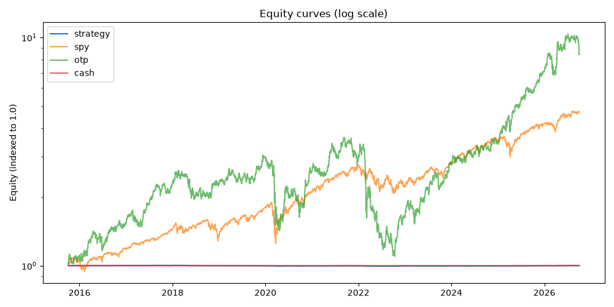
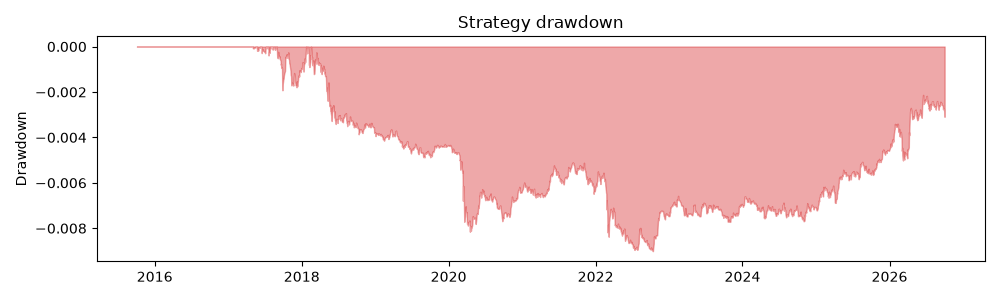
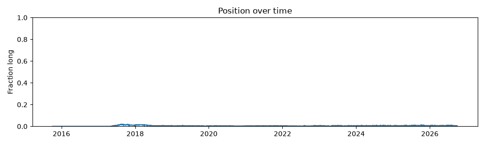

# Backtest report

Metrics for the long-only, costed strategy vs the SPY / OTP
buy-and-hold benchmarks (ADR-0011).

## Result

The strategy returned -0.01% (CAGR -0.00%, Sharpe -0.00, max drawdown -0.90%, 100 trades). It underperformed SPY (+363.46% total return) by 363.47 percentage points. It underperformed OTP (+731.31% total return) by 731.32 percentage points. Cash returned +0.00% over the same window, so the strategy finished below the risk-free alternative.

| Metric | Strategy | Spy | Otp | Cash |
|---|---|---|---|---|
| Total return | -0.01% | 363.46% | 731.31% | 0.00% |
| CAGR | -0.00% | 14.94% | 21.21% | 0.00% |
| Sharpe | -0.0046 | 0.8808 | 0.7536 | 0.0000 |
| Max drawdown | -0.90% | -33.72% | -69.91% | 0.00% |
| Hit rate | 52.64% | — | — | — |
| Turnover | 0.0013 | — | — | — |
| Trades | 100 | — | — | — |

## Plots

