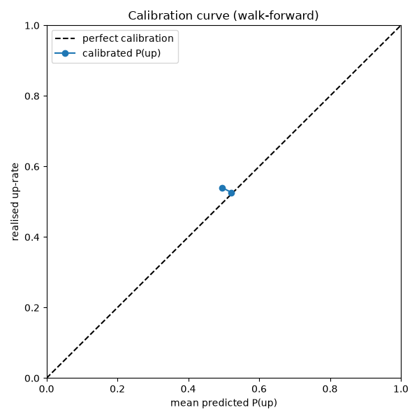

# T4.4 — Calibration to P(next-day up)

Generated by `pressflow.calibrate` (T4.4) from `data/processed/panel.parquet` — 2775 panel rows, 2360 with a walk-forward calibrated probability (ADR-0003, ADR-0009).

## Method

- **Model:** L2 logistic regression (scikit-learn), feature(s) `score_wmean` (best signal from T4.3).
- **Scheme:** walk-forward expanding window — for each day `t` the model is fit on days strictly before `t` and predicts `t` (no lookahead, ADR-0010).
- **Warm-up:** the first `min_warmup = 120` usable observations are not calibrated (they map to cash).
- **Shrink:** `p̃ = 0.5 + 0.5·(p̂ − 0.5)` (ADR-0009); the raw `p_up` is what the T5.1 backtest consumes — it applies its own shrink, so pre-shrinking here would double-count (stored separately as `p_up_shrunk`).

## Scores

| forecast | Brier (raw sample) | note |
|---|---|---|
| calibrated `p_up` | **0.2497** | walk-forward logistic |
| shrunk `p̃` | 0.2497 | γ = 0.5 |
| constant base rate (0.527) | 0.2493 | climatology |
| constant 0.5 | 0.2500 | naive |

Lower Brier is better. Brier scores are evaluated on the calibrated sample only (the warm-up rows carry the neutral 0.5 and are excluded from the curve and scores).

The calibrated `p_up` Brier — 0.2497 — **is not better than the constant-base-rate climatology (0.2493)** on this window, so the logistic signal adds no measurable forecast skill over the base rate here. Predictions are tightly clustered, spanning only ≈ [0.48, 0.58].

## Calibration curve

Binned predicted vs realised up-rate over 2360 days (ECE = 0.0053):

| bin | n | mean p̂ | realised up-rate |
|---|---|---|---|
| 0.0–0.1 | 0 | – | – |
| 0.1–0.2 | 0 | – | – |
| 0.2–0.3 | 0 | – | – |
| 0.3–0.4 | 0 | – | – |
| 0.4–0.5 | 50 | 0.496 | 0.540 |
| 0.5–0.6 | 2310 | 0.522 | 0.526 |
| 0.6–0.7 | 0 | – | – |
| 0.7–0.8 | 0 | – | – |
| 0.8–0.9 | 0 | – | – |
| 0.9–1.0 | 0 | – | – |

## No-lookahead

- Rows with `signal_date >= date`: **0** (must be 0) — the signal is day `t−1`, the label is day `t`'s return (T4.2).
- The expanding-window fit uses only rows `< t`, so no day `t` or later information enters the prediction for `t`; enforced by `tests/test_calibration.py::test_no_lookahead_ignores_future_rows` (future-row leakage) and `test_no_lookahead_ignores_the_label_at_row_t` (fit must not include row `t` itself).

## Artifacts

- `data/processed/panel_calibrated.parquet` — per-day `p_up` (raw, feeds the backtest) and `p_up_shrunk` (report only).
